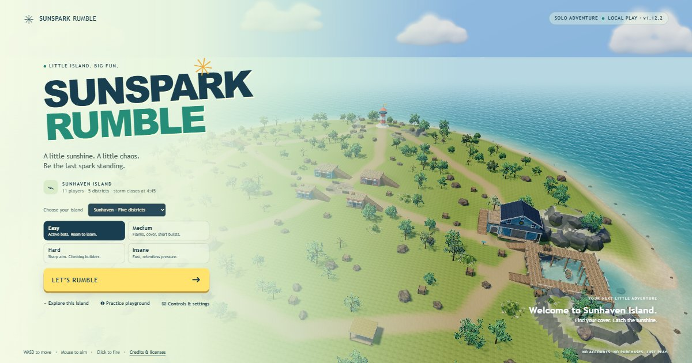

# Sunspark Rumble

A sunny, original third-person island battle royale that runs in a desktop browser. Eight or ten playful bots, four toy blasters, connected cover building and a shrinking purple storm.



## Play

**Play online:** <!-- PLAY_URL -->

**Play offline:** download the portable ZIP from [GitHub Releases](https://github.com/QuinnGT/sunspark-rumble/releases), extract it, and open `index.html` in a recent Chrome, Edge or Firefox on a desktop computer. Keep the extracted files together. On Windows you can double-click **Launch Sunspark Rumble.cmd** instead. The portable edition needs no account, internet connection or installation.

The game needs a browser with WebGL 2, a keyboard and a mouse. It has no touch controls, multiplayer, chat, payments, tracking or accounts. Bots run locally in your browser. Match results are not saved; your settings are, when browser storage is available.

Version history is in [PATCH-NOTES.md](PATCH-NOTES.md).

## How to play

Choose **Sunhaven** or **Breezy Bay**, then a difficulty and **Let’s Rumble**. **Explore this island** lets you learn the selected map without enemy attacks or a storm. The **Practice playground** has a respawning target and no storm or enemy attacks, so it is a good first stop.

### Sunhaven districts

- **Sunbeam Village:** four coastal buildings, a courtyard, open interiors and reachable roofs.
- **Lantern Heights:** the lighthouse headland and lookout cover.
- **Orchard Grove:** planted tree rows, low stone walls and an open shed.
- **Driftwood Docks:** a tall pitched boathouse, sheltered porch, workshop roof terrace, rocky cove, spreading oaks and connected boardwalks.
- **Pebble Quarry:** three stone terraces, broad ramps and downhill sliding.

A path loop and central routes connect every district. Starting spots and supplies vary each match. Swimming is not included: use the dock boardwalks. An accidental fall into the deep cove returns you to dry ground. Boats are scenery.

### Choose your challenge

| Level | What to expect |
| --- | --- |
| Easy | Active opponents, forgiving aim, two-shot bursts, long reload breaks, and a six-second opening grace. Usually one bot focuses on you at a time. |
| Medium | Wider awareness, three-shot bursts, flanking, cover, and occasional building and climbing. |
| Hard | Faster reactions, more accurate leading shots, four-shot bursts, and frequent use of elevated routes and builds. |
| Insane | Very fast reactions, five-shot bursts, aggressive movement, better tracking, and the largest building budget. Keep moving and use cover. |

Bots see within a field of view, investigate nearby gunfire and remember where they last saw you. Cover blocks their sight and shots. Their magazines run empty and need real reloads: a cyan ring and a **RELOADING** label when you aim at one mark your opening. Yellow rings indicate incoming fire. Bots build with the same placement rules you do, using their own limited wood (1 / 3 / 5 / 7 pieces on Easy / Medium / Hard / Insane), and their builds can be destroyed. Your difficulty choice saves between sessions.

### Controls

| Action | Control |
| --- | --- |
| Move | W A S D |
| Look | Mouse; arrow keys also work |
| Sprint | Hold Shift |
| Jump | Space; hold for a higher jump, release for a short hop |
| Crouch / stand | C; standing waits until there is headroom |
| Slide | Sprint with Shift + movement, then tap C |
| Leave a slide | Space to jump out, or C to brake into crouch |
| Fire | Left mouse button; hold for repeat fire |
| Aim more closely | Hold right mouse button |
| Switch blasters | 1 / 2 |
| Swap a nearby weapon into the selected slot | E, outside build mode |
| Reload | R; empty magazines reload automatically |
| Enter / leave build mode | B; leaving restores your last blaster |
| Select wall / ramp / floor in build mode | 1 / 2 / 3; Q / E also cycle pieces |
| Rotate a build | R in build mode |
| Place the preview | Left click |
| Pause | Esc or P |

If the browser blocks mouse capture, hold **right mouse and drag** to look, or use the arrow keys. Click the game before using controls.

### Tips

- **Blasters.** You start with **Spark** (steady golden automatic fire, medium range) and **Confetti** (a broad multicolor burst with a little knockback up close). Find **Prism** and **Gumball** pickups around the island, or try all four beside the practice spawn. Walk close to a weapon, pick slot **1 / 2**, check the replacement preview, then press **E**. Your previous weapon drops nearby; swapping never refills ammunition.
- **Prism popper:** click to charge for 0.8 seconds, then it fires an 88-damage rainbow shot automatically. B, R, switching slots and pausing cancel a pending shot without spending ammo.
- **Gumball blaster:** colorful balls bounce once off solid surfaces. A direct hit does 30 damage and a bounced hit does 24, so an angled shot can reach around cover.
- **Pickups.** Yellow ammo boxes refill reserves for both carried weapons, blue bottles restore shield, pink packs restore health, and bundles of wood add building material. Walk over them to collect.
- **Building.** Press **B → 2 → click** to place a ramp, walk up it, and click again when the next preview turns green to extend it. **3** adds a floor or bridge and **1** adds cover. Look up to stack a wall or attach an upper floor. Pieces share a four-unit grid and a three-unit story height, up to 24 units above the local ground. Green previews are valid, red previews explain what is in the way, and **SNAPPED** means the piece connects to an existing build.
- **Wood.** You start with 80. Each piece costs 10, wood pickups give 40, and popping a bot gives 20. Shots can destroy built pieces: aim at one to see its health, watch for **HIT** when your cover is damaged and **BROKE!** when it is gone. The shot that breaks a piece is absorbed; later shots can pass through the gap.
- **Cover.** Use hills, tree trunks, crates and cabins. Closed cabin doors mark solid buildings, and the ramps beside them lead to the roofs. Rooftop crates are solid: walk around them or jump onto their lids.
- **Slide into cover.** Hold Shift + W, tap C, then press Space to jump out. Slides slow on flat ground, carry further downhill and have a short cooldown. Crouching lowers your body and aim; weapons and building still work.
- **The storm.** Watch the white circle on the map. The dashed circle shows its next destination, and an arrow points toward safety if you are outside. It damages health directly. In Breezy Bay it starts at 0:45 and finishes closing at 4:15. In Sunhaven it starts at 0:40, pauses between phases and finishes at 4:45. Rounds generally last about 3–5 minutes.
- **Easy mode** also gives modest aim assistance and shield regeneration after 9 seconds without damage.
- **Pause** to adjust mouse sensitivity, sound and graphics.

### Graphics & FPS

The badge below the map shows your current **FPS** and picture quality. Click it, or choose **Graphics & FPS** from the pause menu or Controls & settings, to change presets.

| Preset | What you get |
| --- | --- |
| Smooth | Detailed materials with simpler distant canopies, clear animated water and sky reflections; no grass or dynamic shadows. |
| Balanced | Rich trees, nearby meadow grass, canopy shadows, and clear refracting shallows. |
| Detailed | Denser grass, farther foliage detail, focused sun shadows and contact shading, higher-resolution refraction and coastal reflections. |

Start with **Balanced**, play for a few seconds, then compare in the same spot and during a fight. Aim for a steady 60 FPS or more; if play feels choppy or often falls below 30, lower the quality. Changes apply immediately without restarting the match, and the preset and **Show FPS while playing** setting save on this computer. All presets keep the same collision, building, bot behavior and match rules.

## Development

Node.js 22 or newer is needed to build and test. Node is not needed to play.

```sh
npm ci
npm test               # rules, engine, collision, geometry and surface tests (renderer stubbed)
npm run build          # esbuild: src/game.js -> game.bundle.js (Three.js and all assets inside)
npm start              # local server at http://127.0.0.1:4173 (this computer only; stop with Ctrl+C)
npm run build:web      # static site in dist/ (run npm run build first)
npm run package:release  # portable folder in release/ (runs the surface gate first)
```

Rebuild and refresh after source edits. Tree geometry is generated locally from EZ-Tree, photographed terrain, bark and rock maps and leaf cutouts are embedded in the bundle, and sound is generated with Web Audio. The generated texture and model modules under `src/generated/` are checked in, so a normal build does not download anything. `npm run prepare:nature` and `npm run prepare:docks` regenerate them; see `assets/nature/README.md` and `assets/docks/README.md`.

### Surface construction rules

Read [AGENTS.md](AGENTS.md) and [design/surface-construction.md](design/surface-construction.md) before changing geometry, terrain, decoration, batching or collision visuals. `npm run test:surfaces` and `npm run check:surfaces` audit the real batched geometry for overlapping layers and floor/terrain clearance. `npm run package:release` blocks on a failed gate. Renderer and shader rules and measured limits are in [design/threejs-readiness.md](design/threejs-readiness.md).

### Browser checks

The browser tests drive an installed Chrome through `playwright-core` and expect **Windows Chrome** at `C:/Program Files/Google/Chrome/Application/chrome.exe`. They are not run in CI. Build the QA bundle, start the server, then run a script in a second terminal:

```sh
npm run build:qa
npm start
npm run test:browser                # keyboard/mouse play-through
node tests/browser-visual.mjs       # 1980×1140 captures
node tests/browser-offline.mjs      # packaged direct-file build with networking off
npm run test:surfaces:browser       # moving-camera surface views and traversal
npm run test:beams:browser          # doorway frames in all presets
npm run test:render-readiness       # also test:graphics-readiness, test:startup-readiness
npm run test:docks                  # fixed docks comparison views
```

Test hooks and fixtures exist only in the QA bundle; the release bundle does not contain them. `npm run build:qa` also writes `tests/scenario.html` for manual checks at `http://127.0.0.1:4173/tests/scenario.html?scenario=<name>`:

- `cover-check`: build a wall with B / 1 / click and walk against it. The fixture's buttons fire controlled bot shots: eight leave the wall at 38/150 with your shields untouched, three more break it without hurting you, and the next reduces shields. Add `&kind=ramp`, or `&kind=floor&side=below` / `&kind=floor&side=above`, to test other pieces.
- `art-tour`: a visual tour. Add `&spot=cabin`, `coast`, `shore`, `sunlit` or `meadow` to choose the starting view.
- `roof-crate`, `scenery-spacing` and `camera-cover`: screenshot regressions for rooftop crate collision, tree and rock spacing, and the camera in front of a wall.

### Source map

- `src/game.js`: match, input, camera and loadout.
- `src/world.js`, `src/navigation.js`: arena, collision and bot routes.
- `src/bots.js`, `src/actor.js`: bot perception, combat and tactics; characters.
- `src/building.js`, `src/projectiles.js`, `src/weapon-models.js`: build placement, gumball flight, blaster models and reload animation.
- `src/materials.js`: local texture tiles, rounded meshes and decoration batching.
- `src/nature-water.js`, `src/nature-foliage.js`, `src/nature-ground.js`, `src/nature-renderer.js`: ocean, sky and reflections; trees; terrain, rocks and grass; depth contact shading.
- `src/audio.js`, `src/config.js`: sound and tuning.

[VISUAL-UPGRADE-PLAN.md](VISUAL-UPGRADE-PLAN.md) records the approved nature art direction. [design/docks-milestone.md](design/docks-milestone.md) covers the Driftwood Docks milestone.

## Deployment

The hosted game is a static site: `npm run build:web` collects the page and the bundle into `dist/` with precompressed `.gz` files, and a small nginx image serves it. The production build runs `npm ci`, `node scripts/check-surfaces.mjs`, `npm run build`, then `npm run build:web`. Set the `SITE_URL` build variable (for example `https://rumble.example.com`) to make the share-preview and canonical URLs absolute. [docs/deploy-dokploy.md](docs/deploy-dokploy.md) walks through deploying with Docker on Dokploy. GitHub Actions runs the same steps, plus the tests, on every push and pull request to `main`.

## Credits & licenses

- Sunspark Rumble's code is released under the [MIT License](LICENSE).
- [Three.js](https://threejs.org/) and [EZ-Tree](https://github.com/dgreenheck/ez-tree) are MIT. Their notices are in `THIRD-PARTY-NOTICES.txt`.
- [Poly Haven](https://polyhaven.com/license) photographed materials and the [Quaternius](https://quaternius.itch.io/stylized-nature-megakit) Stylized Nature MegaKit rocks are CC0.
- The procedural textures generated by `scripts/prepare-coastal.mjs` are project work, released under the MIT License.
- The teal timber atlas and the concept art were generated with OpenAI’s image tool. The prompts are kept in `design/art-proof` and `design/concepts`.

Full notices and source links are in [THIRD-PARTY-NOTICES.txt](THIRD-PARTY-NOTICES.txt).
