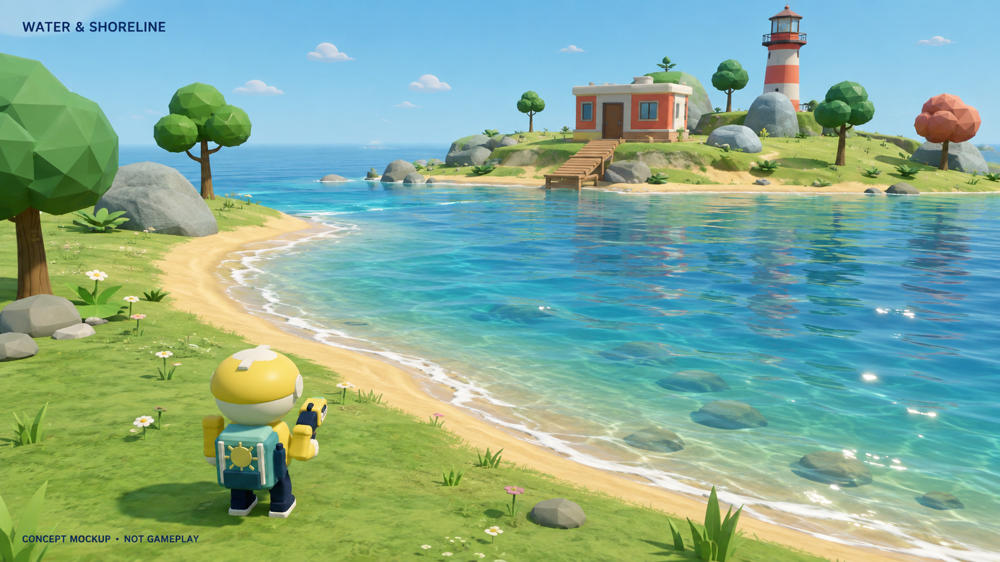
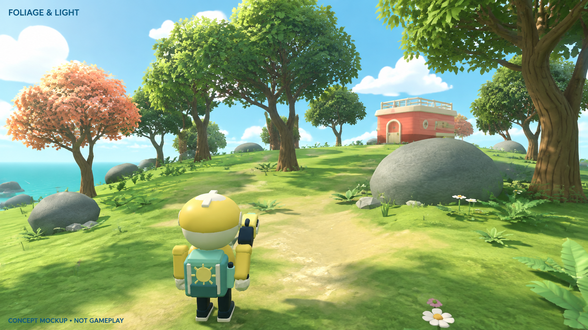

# Breezy Bay — natural scenery concepts

AI-generated concept mockups created with the built-in image-generation tool on September 7, 2026. These illustrate a proposed visual direction, not implemented gameplay, exact arena layouts, or measured rendering performance. The playable game and portable ZIP were not modified for these previews.

## Water and shoreline

Clear turquoise shallows, gentle ripples, sky/shore reflections, sun glints, and a thin foam edge. The simple explorer and colorful architecture stay familiar.

## Foliage and light

Individual leaf clusters, branching trunks, peach accents, open sightlines, and softly dappled light. Rocks and trunks remain separate, grounded objects.

Recommended direction: combine the water treatment from the first image with the foliage treatment from the second. Actual geometry density, reflections, and shadows need profiling in a full match before committing to this level of detail.

[Exact generation prompts](PROMPTS.md). The user's two attached gameplay screenshots supplied the existing character and island references.

